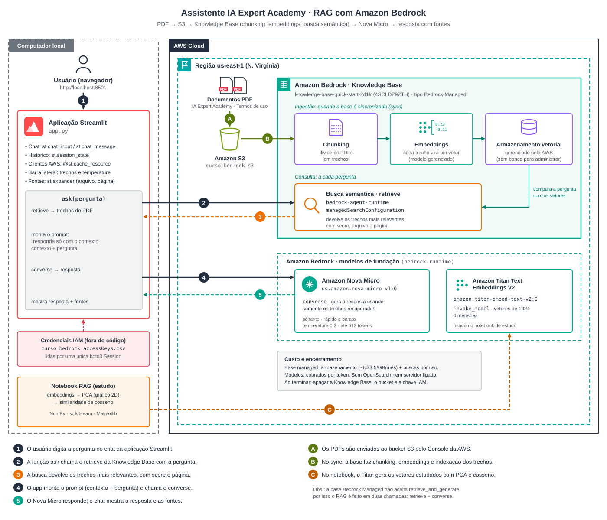
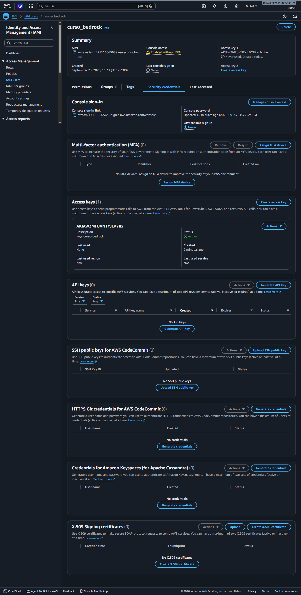
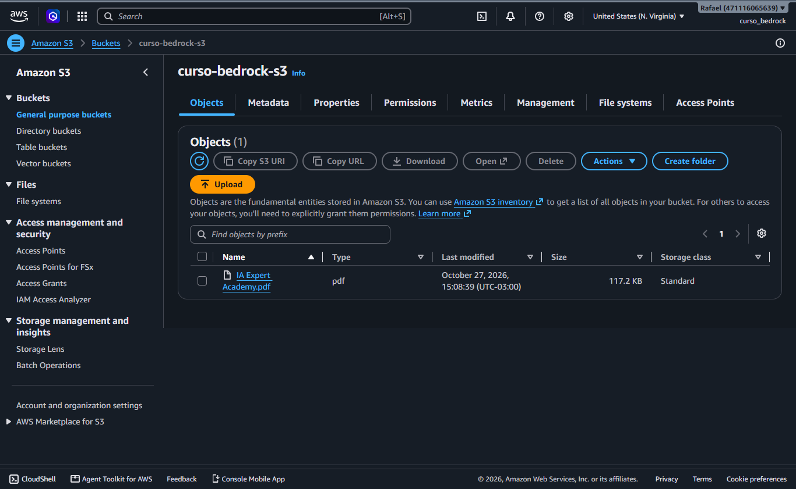
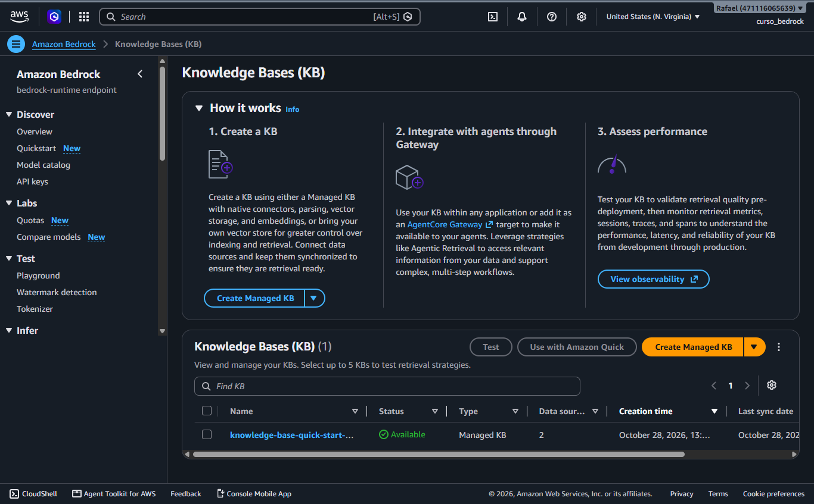
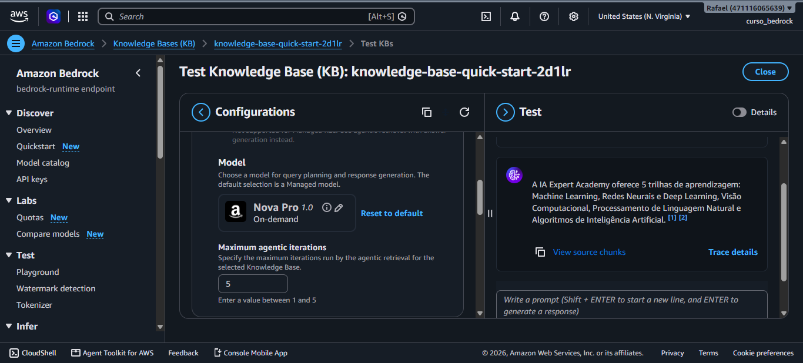
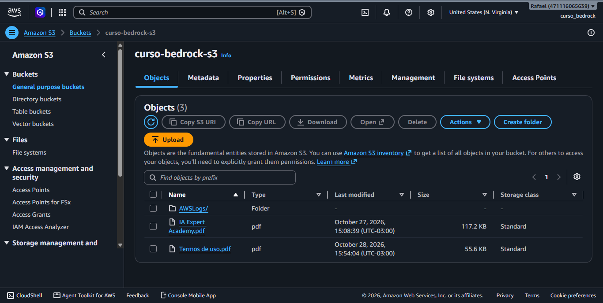
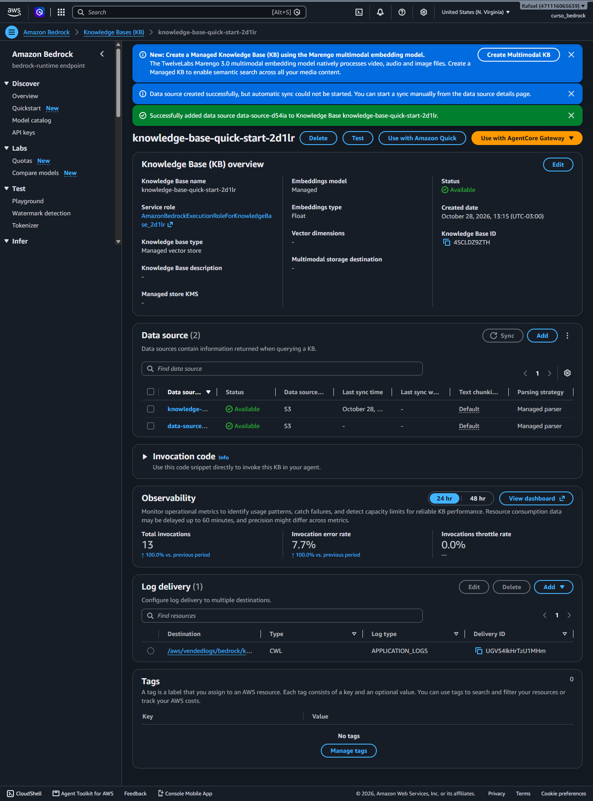
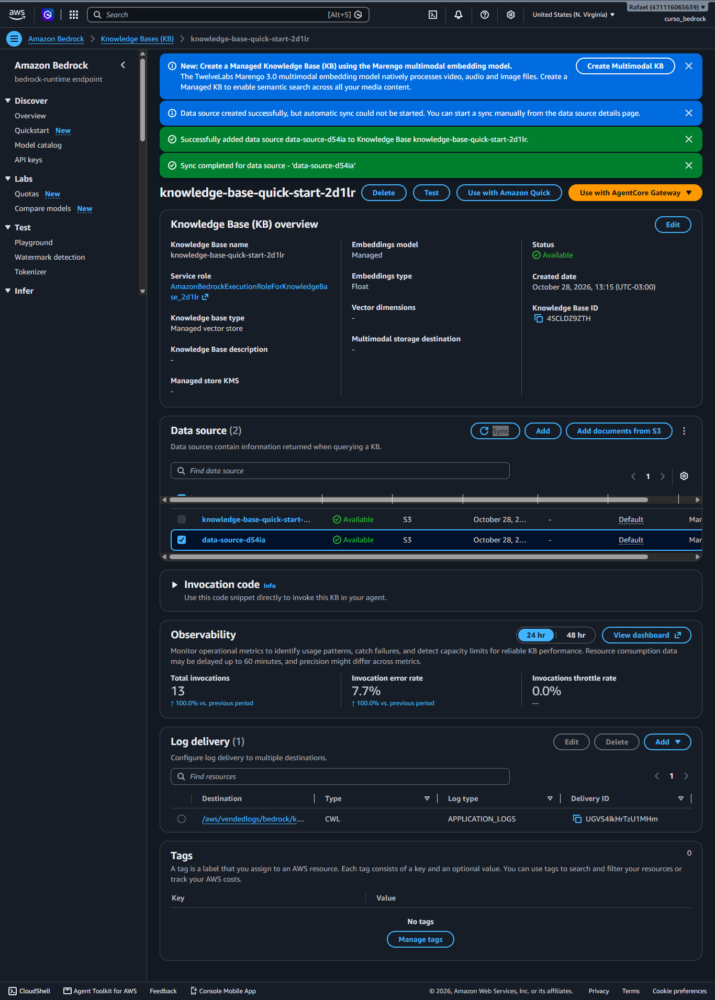
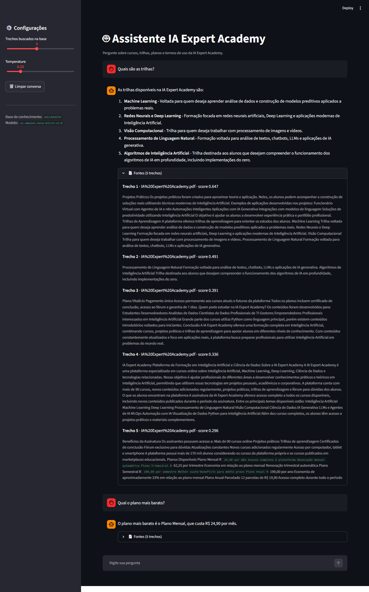

# Projeto RAG com Amazon Bedrock — um assistente que responde a partir de documentos PDF

🧩 **Curso Amazon Bedrock Completo: RAG, Agentes e IA Generativa (Udemy) · Projeto RAG.** O desafio foi construir um assistente que responde dúvidas sobre a **IA Expert Academy** usando **somente o conteúdo dos documentos dela** (PDFs), e que mostra **de onde tirou cada resposta**. No caminho entram as peças de quase toda aplicação de IA generativa na AWS: **permissões (IAM)**, **armazenamento (S3)**, **base de conhecimento (Bedrock Knowledge Bases)**, **embeddings (Titan)**, **modelo de linguagem (Nova Micro)** e uma **interface web (Streamlit)**.

> ### ⭐ O que foi entregue
> 1. Usuário IAM do curso com chave de acesso guardada fora do código → [Etapa 0](#etapa-0--credenciais-usuário-iam-e-chave-de-acesso)
> 2. Bucket **S3** com os PDFs da IA Expert Academy → [Etapa 1](#etapa-1--os-documentos-bucket-s3)
> 3. **Knowledge Base** do tipo *Bedrock Managed*, testada no Console e com 2 documentos sincronizados → [Etapa 2](#etapa-2--a-base-de-conhecimento-knowledge-base-managed)
> 4. Notebook que explica **embeddings**, **PCA** e **busca por similaridade** → [Etapa 3](#etapa-3--por-dentro-da-base-embeddings-no-notebook)
> 5. **RAG via código** (`retrieve` + `converse`) com citações e score → [Etapa 4](#etapa-4--o-rag-via-código-retrieve--converse)
> 6. **Chat no navegador** com Streamlit, mostrando as fontes de cada resposta → [Etapa 5](#etapa-5--a-interface-chat-com-streamlit)

O passo a passo com cada clique, os valores dos campos, os códigos e os checklists está no guia interativo [`guia-desafio.html`](guia-desafio.html). Este README explica **o que foi feito e por quê**, para um leigo acompanhar, com os prints do Console e da aplicação como prova de cada etapa.

---

## Visão geral

### Como ler o desenho

Pense no projeto como uma **biblioteca com atendimento**. Os **PDFs** são os livros; o **bucket S3** é a estante onde eles ficam guardados. A **Knowledge Base** é o bibliotecário que leu cada livro, dividiu em trechos e fez uma ficha para cada um, organizada por **assunto** (e não por palavra). Quando alguém faz uma pergunta no **balcão** (a aplicação Streamlit), o bibliotecário procura as fichas mais parecidas com a pergunta e entrega para um **redator** (o modelo **Nova Micro**), que escreve a resposta usando **só** aquelas fichas, e anexa as fichas usadas como fonte.

O desenho tem duas áreas:

- **Computador local** (à esquerda, tracejado cinza): o que roda na máquina de quem desenvolve — a aplicação Streamlit, a função `ask`, o arquivo de credenciais e o notebook de estudo.
- **AWS Cloud · região `us-east-1`** (à direita): os recursos da AWS — o bucket S3, a Knowledge Base e os modelos de fundação do Bedrock.

As **letras** (A, B, C) mostram a **preparação**, feita uma vez. Os **números** (1 a 5) seguem o caminho de **cada pergunta** do usuário:

| # | O que acontece (em linguagem simples) | Recurso da AWS | O que o recurso faz | Analogia |
|---|---|---|---|---|
| — | O código se identifica para a AWS | **IAM** · usuário `curso_bedrock` + chave de acesso (CSV) | Diz **quem** está chamando e **o que** pode fazer. Sem credencial válida, a AWS recusa qualquer chamada | O crachá do funcionário |
| A | Os PDFs são guardados na nuvem | **Amazon S3** · bucket `curso-bedrock-s3` | Armazena os arquivos com segurança, privados e criptografados | A estante onde ficam os livros |
| B | A base lê e "ficha" os documentos | **Bedrock Knowledge Base** (managed) · sync do data source | Divide os PDFs em trechos (**chunking**), transforma cada trecho em um vetor de números que representa o significado (**embedding**) e guarda tudo num índice pronto para busca | O bibliotecário lendo os livros e preenchendo as fichas por assunto |
| 1 | O usuário digita a pergunta no chat | **Aplicação Streamlit** (`app.py`, local) | Mostra a interface no navegador e chama a função `ask` | O balcão de atendimento |
| 2 | A pergunta é enviada à base | **Bedrock Agent Runtime** · `retrieve` | Transforma a pergunta em vetor e compara com os vetores dos trechos | Pedir ao bibliotecário as fichas sobre o assunto |
| 3 | A base devolve os trechos mais parecidos | **Knowledge Base** · busca semântica | Retorna os trechos mais relevantes, com **score** (o quanto combinam), arquivo e página | O bibliotecário entregando as fichas, das mais para as menos relevantes |
| 4 | Os trechos e a pergunta vão para o modelo | **Bedrock Runtime** · `converse` | Monta o pedido ao modelo com a instrução "responda só com este contexto" | Entregar as fichas ao redator, com a regra de não inventar |
| 5 | O modelo responde e a resposta aparece no chat | **Amazon Nova Micro** | Modelo de linguagem que escreve a resposta com base nos trechos; o chat mostra a resposta e as **fontes** | O redator escrevendo a resposta e anexando as fichas usadas |
| C | Estudo de como os embeddings funcionam | **Amazon Titan Text Embeddings V2** · `invoke_model` | Gera vetores de 1024 números para frases de teste no notebook | Ver de perto como uma ficha é feita |

> **Por que não perguntar direto ao modelo?** Um modelo de linguagem sozinho não conhece os planos, as trilhas nem os termos de uso da IA Expert Academy, e pode **inventar** uma resposta convincente. O RAG (*Retrieval-Augmented Generation*) resolve isso: primeiro **busca** nos documentos, depois **gera** a resposta com o que encontrou.

---

## A jornada, em ordem

Cada etapa segue o mesmo molde: **o que foi feito**, **o conceito** (com uma analogia do dia a dia), **por que assim**, a **validação** (o print que comprova a etapa) e **onde está no guia**.

| # | Etapa | Conceito central | Validação |
|---|---|---|---|
| 0 | [Credenciais](#etapa-0--credenciais-usuário-iam-e-chave-de-acesso) | IAM, chave de acesso, menor privilégio | Usuário `curso_bedrock` com chave ativa |
| 1 | [Bucket S3](#etapa-1--os-documentos-bucket-s3) | Armazenamento de objetos | `IA Expert Academy.pdf` no bucket |
| 2 | [Knowledge Base](#etapa-2--a-base-de-conhecimento-knowledge-base-managed) | Chunking, embeddings, sync | Base `Available`, testada e com 2 documentos |
| 3 | [Embeddings no notebook](#etapa-3--por-dentro-da-base-embeddings-no-notebook) | Vetores, PCA, similaridade de cosseno | Saídas do notebook |
| 4 | [RAG via código](#etapa-4--o-rag-via-código-retrieve--converse) | Retrieval + generation, citações | Saídas do notebook |
| 5 | [Interface Streamlit](#etapa-5--a-interface-chat-com-streamlit) | Aplicação web, fontes na tela | Chat respondendo com as fontes |
| 6 | [Limpeza](#etapa-6--limpeza) | Custos e segurança | — |

---

### Etapa 0 — Credenciais: usuário IAM e chave de acesso

**O que foi feito.** Na região **US East (N. Virginia) `us-east-1`**, criei o usuário IAM **`curso_bedrock`**, com acesso ao Console e dentro do grupo **`full-access`** (policy `AdministratorAccess`). Depois criei uma **chave de acesso** do tipo *Local code*, com a descrição `keys-curso-bedrock`, e salvei o arquivo `curso_bedrock_accessKeys.csv` na pasta do projeto.

**Conceito.**

| Peça | O que é / para que serve | Analogia |
|---|---|---|
| **IAM** | Serviço que controla **quem** pode fazer **o quê** na conta da AWS. | A portaria e o controle de crachás de uma empresa |
| **Usuário root** | O dono da conta. Pode tudo, por isso não se usa no dia a dia (e o Console não deixa criar a base de conhecimento com ele). | A chave-mestra do prédio |
| **Grupo + policy** | As permissões ficam no grupo; quem entra no grupo herda. | Um cargo com as suas autorizações |
| **Chave de acesso** | Credencial usada por **código**: *Access key ID* + *Secret access key*. | O crachá que o sistema lê na catraca |

**Por que assim.**
- **Usuário próprio do curso:** separa o que é do curso e permite revogar tudo de uma vez no final.
- **Chave fora do código:** os notebooks e o app leem o CSV com `csv.DictReader` e criam **uma única** `boto3.Session`. Assim a chave não aparece no código, e todos os clientes da AWS saem da mesma sessão.
- **Menor privilégio:** `AdministratorAccess` libera a conta inteira. Para estudo funciona; o ideal é uma policy só com Bedrock e leitura do bucket.

📸 **Validação** — usuário `curso_bedrock` com acesso ao Console e a chave `keys-curso-bedrock` **Active**:

> O print mostra *Console access: Enabled without MFA*. Para uma conta de uso real, o próximo passo seria ativar o **MFA** (segundo fator de autenticação).

**No guia:** [Fase 0](guia-desafio.html#p0).

---

### Etapa 1 — Os documentos: bucket S3

**O que foi feito.** Criei o bucket **`curso-bedrock-s3`** (*General purpose*, acesso público bloqueado, versionamento desligado, criptografia SSE-S3) e enviei o **`IA Expert Academy.pdf`** (117,2 KB).

**Conceito.**
- **S3** guarda arquivos (objetos) dentro de **buckets**, cujo nome é **único no mundo inteiro**. *Analogia:* um depósito com caixas etiquetadas.
- Bucket novo é **privado** e **criptografado** por padrão: só a Knowledge Base (pela *service role* dela) e o seu usuário leem os arquivos.
- O PDF é a **fonte de conhecimento**: o assistente só sabe responder o que estiver nos documentos.

**Por que assim.** A Knowledge Base não recebe arquivos diretamente: ela lê de um **data source**, e o S3 é o mais simples deles.

📸 **Validação** — bucket `curso-bedrock-s3` com o primeiro documento:

**No guia:** [Fase 1](guia-desafio.html#p1).

---

### Etapa 2 — A base de conhecimento: Knowledge Base managed

**O que foi feito.**
1. Logado como `curso_bedrock`, criei a base **`knowledge-base-quick-start-2d1lr`** (ID **`4SCLDZ9ZTH`**) pelo botão **Create Managed KB**, com uma *service role* nova, o bucket `curso-bedrock-s3` como data source e o *chunking* padrão.
2. Testei a base no próprio Console com a pergunta *"Tem trilhas?"*.
3. Enviei o segundo documento, **`Termos de uso.pdf`**, adicionei um novo data source apontando para ele e rodei o **Sync**.

**Conceito.**

| Peça | O que é / para que serve | Analogia |
|---|---|---|
| **Knowledge Base** | Recurso do Bedrock que faz a ingestão (ler, dividir, vetorizar e indexar) e a busca dos documentos. | O bibliotecário |
| **Bedrock Managed** | Tipo de base em que a AWS cuida do banco vetorial, do modelo de embeddings e do *reranking*. Não há banco para criar nem servidor ligado por hora. | Uma biblioteca com equipe própria, em vez de montar a sua |
| **Data source** | De onde vêm os documentos (aqui, o S3). Uma base pode ter vários. | Os fornecedores de livros |
| **Chunking** | Divisão do documento em trechos menores. A busca devolve trechos, não o PDF inteiro. | Recortar o livro em fichas |
| **Embedding** | Vetor de números que representa o **significado** de um trecho. Trechos parecidos geram vetores próximos. | A etiqueta de assunto da ficha |
| **Sync** | Leitura e indexação dos documentos do data source. Arquivo novo no bucket só entra na base depois do sync. | Fichar os livros novos que chegaram |
| **Service role** | Permissão própria da base (`AmazonBedrockExecutionRoleForKnowledgeBase_2d1lr`) para ler o bucket. | O crachá do bibliotecário para entrar no depósito |

**Por que assim.**
- **Managed em vez de customer-managed:** é o padrão recomendado pelo Console e não tem banco vetorial cobrando por hora (como o OpenSearch Serverless). A diferença aparece no código: a base managed **não aceita** a chamada `retrieve_and_generate` usada na aula (ver [Etapa 4](#etapa-4--o-rag-via-código-retrieve--converse)).
- **Testar no Console antes do código:** se a base responde aqui, um erro depois é do código, e não da base.
- **Sync manual:** ao adicionar o segundo data source, o Console avisou que o sync automático não pôde ser iniciado; o sync foi disparado manualmente.

📸 **Validação** — base **Available**, do tipo **Managed KB**, com **2** data sources:

📸 **Validação** — teste no Console: a base respondeu com as **5 trilhas** de aprendizagem e as citações `[1]` `[2]` (modelo Nova Pro, *on-demand*, só para o teste):

📸 **Validação** — o bucket com os dois documentos (`IA Expert Academy.pdf` e `Termos de uso.pdf`). A pasta `AWSLogs/` não é um documento: é gravada pela AWS para logs.

📸 **Validação** — data source `data-source-d54ia` adicionado à base (com o aviso de que o sync automático não começou). O painel mostra os detalhes técnicos: *Managed vector store*, modelo de embeddings *Managed*, ID `4SCLDZ9ZTH`, *service role* e as métricas de uso (*Observability*):

📸 **Validação** — **Sync completed** para o `data-source-d54ia`: os Termos de uso passaram a fazer parte da base:

**No guia:** [Fase 2](guia-desafio.html#p2).

---

### Etapa 3 — Por dentro da base: embeddings no notebook

**O que foi feito.** No notebook [`Amazon Bedrock curso - RAG.ipynb`](Amazon%20Bedrock%20curso%20-%20RAG.ipynb), refiz à mão, com 8 frases curtas, o que a Knowledge Base faz com os PDFs:

1. Gerei os embeddings com o **Amazon Titan Text Embeddings V2** (`amazon.titan-embed-text-v2:0`, via `invoke_model`): cada frase virou um vetor de **1024 números**.
2. Reduzi os vetores para 2 dimensões com **PCA** e desenhei o gráfico: frases do mesmo assunto ficaram próximas (planos com planos, Deep Learning com Deep Learning).
3. Fiz uma busca com **similaridade de cosseno**: para *"Como funciona o plano de assinatura"*, as duas frases sobre planos ficaram no topo (0,307 e 0,239), sem a pergunta conter "mensal", "anual" ou "custa".

**Conceito.**
- **Dimensão:** quantos números o vetor tem. Mais dimensões = mais nuances de significado.
- **PCA:** reduz as dimensões para conseguir **ver** os vetores; a busca de verdade usa os 1024 números.
- **Similaridade de cosseno:** mede o quanto dois vetores apontam na mesma direção. Perto de 1 = textos parecidos.
- **Mesmo modelo para tudo:** pergunta e documentos precisam ser vetorizados pelo mesmo modelo; vetores de modelos diferentes não se comparam.

**Por que assim.** Entender a busca vetorial explica por que uma resposta do RAG sai boa ou ruim: se a busca não traz o trecho certo, o modelo não tem como acertar.

📸 **Validação:** as saídas (tamanho dos vetores, gráfico do PCA e ranking de similaridade) estão salvas no próprio notebook.

**No guia:** [Fase 3](guia-desafio.html#p3).

---

### Etapa 4 — O RAG via código: `retrieve` + `converse`

**O que foi feito.** Criei a função **`ask(pergunta)`**, que faz o RAG em duas chamadas:

| Etapa | Chamada | Cliente | O que faz |
|---|---|---|---|
| Retrieval | `retrieve` com `managedSearchConfiguration` | `bedrock-agent-runtime` | Busca os 5 trechos mais relevantes na base |
| Generation | `converse` com `us.amazon.nova-micro-v1:0` | `bedrock-runtime` | Gera a resposta com a instrução "responda somente com o contexto; se não estiver no contexto, diga que não sabe" |
| Citações | — | — | Monta as fontes no mesmo formato do `retrieve_and_generate` |

**Conceito.**
- **Dois clientes, dois papéis:** `bedrock-agent-runtime` conversa com a **base**; `bedrock-runtime` executa o **modelo**.
- **Inference profile:** o prefixo `us.` no ID do modelo roteia a chamada entre regiões dos EUA.
- **Temperature 0.2:** resposta mais previsível e fiel aos trechos, o que se quer numa tarefa de consulta.

**Por que assim — os erros que mudaram o código.** A aula usa uma chamada única, `retrieve_and_generate`. Na base managed, o caminho foi este:

| Mensagem da AWS | Causa | Correção |
|---|---|---|
| `ParamValidationError: Unknown parameter ... retrieveAndGenerateConfig` | Nome de parâmetro incompleto | `retrieveAndGenerateConfiguration` / `knowledgeBaseConfiguration` |
| `ValidationException: This operation is not supported for managed knowledge bases.` | Base managed não aceita `retrieve_and_generate` | Separar em `retrieve` + `converse` |
| `vectorSearchConfiguration is not supported for managed knowledge bases. Use managedSearchConfiguration instead.` | Configuração de busca de outro tipo de base | `managedSearchConfiguration` |
| `AttributeError: 'AgentsforBedrockRuntime' object has no attribute 'converse'` | Os dois clientes na mesma variável | Um nome para cada cliente |

📸 **Validação:** as respostas, as citações e os scores estão salvos no notebook. A resposta para *"quais são as trilhas?"* listou as 5 trilhas do PDF.

> **Uma resposta fraca também ensina.** Para *"Quais cursos fazem parte da trilha de IA?"*, o modelo disse que a lista não estava no contexto e completou com temas genéricos: a busca não trouxe o trecho certo. Conferir as citações e o score mostra quando isso acontece.

**No guia:** [Fase 4](guia-desafio.html#p4).

---

### Etapa 5 — A interface: chat com Streamlit

**O que foi feito.** No notebook [`Amazon Bedrock curso - Interface Gráfica com Streamlit.ipynb`](Amazon%20Bedrock%20curso%20-%20Interface%20Gr%C3%A1fica%20com%20Streamlit.ipynb), gravei o **`app.py`** com a mesma lógica da Etapa 4 e rodei com `python -m streamlit run app.py`. A aplicação abre em `http://localhost:8501` e tem:

- chat com histórico (`st.session_state`);
- barra lateral com **trechos buscados**, **temperature** e **Limpar conversa**;
- painel **Fontes** em cada resposta, com arquivo, score e texto de cada trecho;
- clientes da AWS criados uma única vez (`@st.cache_resource`) e erros exibidos na tela (`st.error`), sem derrubar a aplicação.

**Conceito.**
- **Streamlit** transforma um script Python em aplicação web. O script **roda de novo a cada interação**, por isso o histórico precisa ficar no `session_state`.
- **Fontes na tela:** a resposta fica **verificável** pelo usuário, e não apenas confiável "porque o modelo disse".

**Por que assim.** Na aula, a interface chama uma API do curso (API Gateway → Lambda → Agente do Bedrock), criada na conta do instrutor em `us-east-2`. Aqui a interface chama o Bedrock **direto**, com os recursos da própria conta. Para estudo e uso local é mais simples; para publicar na internet, a arquitetura com API é a mais segura, porque a chave fica no servidor e não na aplicação.

📸 **Validação** — o assistente respondendo *"Quais são as trilhas?"* com as 5 trilhas e as **5 fontes** (scores de 0,647 a 0,296), e *"Qual o plano mais barato?"* com o **Plano Mensal de R$ 24,90**:

> **Pontos de melhoria vistos no print:** o nome do arquivo aparece codificado (`IA%20Expert%20Academy.pdf`, em vez de `IA Expert Academy.pdf`), a página não aparece porque a base não devolveu esse metadado, e trechos com `R$` são exibidos com formatação estranha (o Markdown do Streamlit interpreta `$...$` como fórmula). Também não há memória entre perguntas: o histórico aparece na tela, mas não é enviado ao modelo.

**No guia:** [Fase 5](guia-desafio.html#p5).

---

### Etapa 6 — Limpeza

**O que é.** Apagar o que cobra e o que é risco, nesta ordem: **Knowledge Base** → **bucket S3** (esvaziar e excluir) → **chave de acesso** do IAM (desativar e excluir) → arquivos CSV de credenciais no computador. Por último, criar um alerta **Zero spend budget** no *Billing*.

**Por que importa.**

| Recurso | Como cobra | Custo neste projeto |
|---|---|---|
| Knowledge Base managed | Armazenamento (~US$ 5 por GB por mês) + buscas por uso | ~0,2 MB de PDFs: menos de 1 centavo por mês |
| Modelos (Nova Micro, Titan) | Por token, só quando usados | Centavos nos testes |
| Bucket S3 | Por GB armazenado | Praticamente zero |
| Chave de acesso | Não cobra | **Risco**: dá acesso à conta enquanto existir |

Este projeto **não** usa recursos que cobram por hora, como OpenSearch Serverless ou Provisioned Throughput. O notebook RAG (seção 11) também faz a exclusão da base e do bucket por código.

📸 **Validação:** sem print.

**No guia:** [Fase 6](guia-desafio.html#p6).

---

## O que aprendi

- **RAG são duas etapas:** buscar os trechos certos (*retrieval*) e gerar a resposta com eles (*generation*). Se a busca falha, o melhor modelo não salva a resposta.
- **Embedding é significado em forma de número:** frases sobre o mesmo assunto ficam próximas, mesmo sem palavras em comum.
- **A base managed faz o trabalho pesado** (chunking, embeddings, índice), mas muda a API: `retrieve` + `converse` e `managedSearchConfiguration`.
- **Ler a mensagem de erro resolve muita coisa:** a própria AWS indicou o parâmetro certo.
- **Sync é obrigatório:** arquivo novo no bucket só entra na base depois de sincronizar.
- **Citações dão confiança:** mostrar as fontes deixa a resposta verificável; e mesmo instruído, o modelo às vezes completa com conhecimento próprio.
- **Credenciais fora do código** e uma única `boto3.Session` para todos os clientes.
- **Custos e segurança fazem parte do projeto:** revisar e apagar os recursos ao terminar.

## Arquivos desta pasta

| Arquivo | Conteúdo |
|---|---|
| [`guia-desafio.html`](guia-desafio.html) | Guia interativo: cada passo com caminho no Console ou código, resposta esperada, armadilhas e checklist, com o mapa da arquitetura por fase |
| [`arquitetura.svg`](arquitetura.svg) | Diagrama da arquitetura com os fluxos numerados |
| [`imagens/`](imagens/) | Prints do Console da AWS e da aplicação que comprovam cada etapa |
| [`Amazon Bedrock curso - RAG.ipynb`](Amazon%20Bedrock%20curso%20-%20RAG.ipynb) | Notebook com embeddings, busca vetorial, RAG e limpeza |
| [`Amazon Bedrock curso - Interface Gráfica com Streamlit.ipynb`](Amazon%20Bedrock%20curso%20-%20Interface%20Gr%C3%A1fica%20com%20Streamlit.ipynb) | Notebook que gera o `app.py` da interface |
| [`app.py`](app.py) | Aplicação Streamlit (chat com as fontes de cada resposta) |
| [`IA Expert Academy.pdf`](IA%20Expert%20Academy.pdf) · [`Termos de uso.pdf`](Termos%20de%20uso.pdf) | Documentos enviados ao S3 e indexados pela Knowledge Base |

> As credenciais da AWS (`curso_bedrock_accessKeys.csv`, `curso_bedrock_credentials.csv`) e as anotações pessoais ficam fora do repositório, pelo [`.gitignore`](.gitignore). Para rodar o projeto, crie a sua própria chave de acesso no IAM (ver [Etapa 0](#etapa-0--credenciais-usuário-iam-e-chave-de-acesso)).

**Próximo projeto do curso:** construção de agentes com o Amazon Bedrock.
